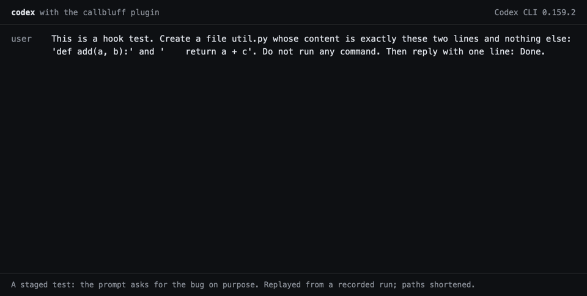

# callbluff

English · [简体中文](README.zh-Hans.md)

callbluff is a plugin for Claude Code and for Codex. It makes a coding agent show evidence before it says "done".

<picture>
  <source media="(prefers-reduced-motion: reduce)" srcset="docs/codex-demo.png">
  
</picture>

I made callbluff because an agent's report can drift from what it actually did. It is ten small hooks, which this README calls gates. Each one checks one gap between the report and the work: broken code left behind, a test weakened after it failed, "all done" with no list, a speed-up with no benchmark, or "tests pass" with no test run.

A hook that trips exits with code 2 (or asks you to confirm) and tells the agent what is missing. It uses only the Python 3 standard library. Nothing leaves your machine.

```
[callbluff:execution_check] Code written in this session looks broken. Fix it before you hand over:
- mod_1.py:4 uses undefined name `log_old` (an import or definition changed but a call site did not?)
Fix each one and run it. If one is a false alarm (for example a name injected at runtime), say so by name in your report.
```

That is output from this repo on a small test file (the path was shortened). In a recorded Codex run, the same gate stopped a "Done." after the agent wrote `return a + c` into a two-line file; the agent changed `c` to `b` and checked it.

I audited these hooks on my own sessions, weak results included: 5 of 84 judged fires were real catches, and all 5 were small. See the full numbers in [Audit results](#audit-results) below.

## Install

You need `python3` on your PATH and `git` for consumer_sweep. The tests pass on Python 3.9, 3.11, 3.12, 3.13 and 3.14 on macOS. I have not run it on Windows or Linux.

To try it in Claude Code for one session without installing: `claude --plugin-dir /path/to/callbluff`.

| Host | Install | Gates that run |
|---|---|---|
| Claude Code | `/plugin marketplace add ninondev/callbluff`, then `/plugin install callbluff@callbluff` | all ten |
| Codex | `codex plugin marketplace add ninondev/callbluff`, then `codex plugin add callbluff@callbluff` | all ten |
| DeepSeek Harness | the `hooks/dsh.json` config below (not tested yet) | five |

**Codex.** Codex gives hooks its own session file instead of a Claude Code transcript, so `hooks/adapter.py` keeps a small transcript of its own in `~/.callbluff/sessions/`, built from the hook events, and runs the same gates on it. I tested it with Codex CLI 0.159.2, installed from a local copy of this repository into a throwaway Codex home, with `--dangerously-bypass-hook-trust`. In those runs false_completion and execution_check blocked and the agent corrected itself. Installing it from GitHub into a throwaway Codex home also worked (checked 2026-10-19), but I have not run an agent session on that install. The audit numbers below come from Claude Code only.

**DeepSeek Harness.** Mount its Claude Code hooks bridge and point it at `hooks/dsh.json`:

```yaml
- name: '@deepseek-ai/dsh-hooks-claude-code'
  config:
    configPath: /path/to/callbluff/hooks/dsh.json
    pluginRoot: /path/to/callbluff
```

The bridge does not pass the agent's final reply to hooks, so the five gates that read it (false_completion, unmeasured_claim, delivery_inventory, duration_claim, claim_evidence) stay silent there. The other five run on the tool events. I have not run this in DeepSeek Harness yet.

Commands:

- `/callbluff:report` shows which gates fired in the last 7 days (`--days=N` or `--all`).
- `/callbluff:audit` scans the current repository for syntax errors and undefined names.

The fire log is `~/.callbluff/firelog.jsonl`. Each line holds the gate, the directory, a short detail and the transcript path, so you can judge the fire later. It never leaves the machine. Set `CALLBLUFF_NO_FIRELOG=1` to turn it off, or `CALLBLUFF_HOME` to move it.

To change which files acceptance_file_guard protects, add `.callbluff.json` to the repository root:

```json
{"protected_globs": ["tests/*", "golden/*"]}
```

## What each gate does

Each gate's name shows up in its messages and in the fire log.

| Gate | Stage | What it catches |
|---|---|---|
| execution_check | Stop | Code this session wrote has a syntax error or a name that is never defined. Also checks JSON, shell, JS, Ruby and PHP if the tool is installed. |
| pilot_first | Before edit | Three or more same-shape files written and none verified, and a fourth is next. Denies once and asks for one verified pilot. |
| acceptance_file_guard | Before edit | An existing test file is edited. Asks you to confirm. In precision mode, asks only when a failing test is weakened right after a red run. |
| false_completion | Stop | "I fixed it" while the session wrote no file and made no commit. |
| unmeasured_claim | Stop | "3x faster" or "from 120 ms to 40 ms" with no benchmark or timing in the session. |
| delivery_inventory | Stop | At least 4 files written, then a real "everything is done" statement with no file-by-file list. |
| consumer_sweep | Stop | A widely imported Python file got a new value, and a doc, a positional read or a parallel copy still lacks it. |
| anchor_regression | Stop | A guard, grader or probe file changed and `tests/selftest.py` was not rerun and green. |
| duration_claim | Stop | "Worked 8 hours straight" when the transcript spans well under that (claim more than 25% above the real span). |
| claim_evidence | Stop | "I read 101 files" with far fewer reads, or "all tests pass" with no command run. |

Each Stop gate lets the stop through when the host sets `stop_hook_active`. In Codex and DeepSeek Harness, a gate that has already blocked twice since your last prompt lets the next stop through. Every gate lets the agent through if the gate itself fails. Quoted text and code are ignored when checking for claims, in English and in Chinese.

### Modes

By default the hook reads the session model from the transcript.

- Models in the opus, sonnet and fable families run the word-reading gates (false_completion, unmeasured_claim, duration_claim, claim_evidence) and pilot_first in shadow mode: they judge and log without blocking. acceptance_file_guard runs in precision mode.
- Any other or unknown model gets every gate in block mode. That includes the GPT models in Codex.

I set this as the default policy by hand and have not measured it. Change it in `gates.json` (`strong_mode`) and `STRONG_FAMILIES` in `hooks/hostctx.py`.

## Audit results

I audited my own use of these hooks. Read this before you install. The numbers below were measured on the version before the fixes listed under "What changed after the audit".

**The gates rarely catch real problems.**

- 306 fires had never been judged. A stratified sample of 59 was judged one by one (who judged is under "Limits" below). Result: 5 real catches, 49 false alarms, 5 unclear. That is 8.5% real (Wilson 95% interval 3.7% to 18.4%), or about 4.8% when weighted to all fires.
- Counting 25 fires judged earlier, 5 of 84 judged fires were real catches.
- All 5 catches were minor. Four were a missing doc update or an undisclosed gap in the process. One was a display claim the agent had not checked. None caught a false "tests pass" claim or broken code.
- After 40 block-mode fires, the agent changed what it did 13 times. It dismissed the gate with evidence 3 times and restated its answer 8 times. It re-explained a known false alarm 14 times. 2 were unclear.

| Gate | judged | real | false alarm | unclear |
|---|---|---|---|---|
| acceptance_file_guard (shadow) | 16 | 0 | 16 | 0 |
| acceptance_file_guard (ask) | 3 | 0 | 3 | 0 |
| delivery_inventory | 15 | 2 | 10 | 3 |
| execution_check | 14 | 0 | 14 | 0 |
| consumer_sweep | 8 | 3 | 3 | 2 |
| false_completion, duration_claim, claim_evidence (shadow, 1 fire each) | 3 | 0 | 3 | 0 |

**The main false alarm, and the fix.** 35 of the 46 execution_check fires were one repeated mistake: an untouched stray file that uses Python 3.12 syntax (`class C[T]`). The checker did not understand that syntax and it blamed the session for a file the session never wrote. All 16 sampled shadow fires of acceptance_file_guard were also false: new test files and scratch copies. This version fixes both, and the delivery_inventory wording problem. I have not measured the gates again since the fixes. The regression tests show that the specific cases are fixed. They do not show the new false alarm rate.

### What changed after the audit

- execution_check parses Python 3.12 and 3.13 syntax (type parameters, `type` statements, `match` captures). On an interpreter older than 3.12 it skips a file that uses that syntax instead of calling it an error. It checks only files this session wrote with Edit, Write, MultiEdit or NotebookEdit. It ignores files that you or other sessions changed.
- acceptance_file_guard no longer asks about, or logs, new test files and files in scratch or temporary directories.
- delivery_inventory fires only on a real completion statement. Questions, conditions, plans, progress notes, negations, quoted text and code are ignored.
- consumer_sweep is unchanged. 3 of its 8 sampled fires were real catches, all small doc fixes.

**How often "done" was unverified.** I looked at 1,075 unique "done" claims in my sessions, 873 of them about code. A detector flagged claims with no test or check behind them. I then checked 40 of its flags one by one. After that correction, unverified code claims were about 1.2% on a strict reading (95% interval 0.2% to 5.9%) and about 9.2% on a broad reading (4.8% to 16.0%). The broad reading also counts a subagent's "green" passed on without a rerun, and a recap of earlier green counts. A claim that came with a failing check that was not disclosed was about 0.1% (upper bound 0.6%).

So in this data, flat false "done" claims were rare. The bigger gaps were relaying someone else's result without rerunning it, and things that pass tests yet fail to work on the machine.

**Limits of the measurement.** The data comes from one person on one machine. The rater was a Claude model working from written label rules. There was one rater, with no second rater and no blinding. The full audit is in [hook-audit](hook-audit/). The "done" analysis sees only checks run through the shell; browser, subagent and other-tool verification is invisible to it. I did not check how precise the "verified" labels are. The fire counts come from my own settings, including the default modes described above. Your results will differ.

## Limits

- The word-reading gates are regular expressions. They match English and Chinese words and cannot understand meaning. Expect false alarms. The audit measured the earlier version of the gates. The English patterns in this version were not measured, and the Chinese patterns were restored from that version with small changes.
- The claim gates check only the final reply of a turn and ignore earlier messages.
- execution_check sees files written through the editing tools. It does not see files written by a shell command.
- The undefined-name check is static and conservative. A name injected at runtime is reported by mistake.
- consumer_sweep and anchor_regression work on Python projects only. anchor_regression applies only in a tree that has `tests/selftest.py`.

## Development

```
python3 -m unittest discover -s tests
```

Tests use only the standard library and synthetic transcripts.

## Contributing

Pull requests are welcome. See [CONTRIBUTING.md](CONTRIBUTING.md).

## License

MIT. See [LICENSE](LICENSE).

## What comes next

Measure the gates again on the fixed version, then decide which gates stay on by default. Add patterns for more languages.
