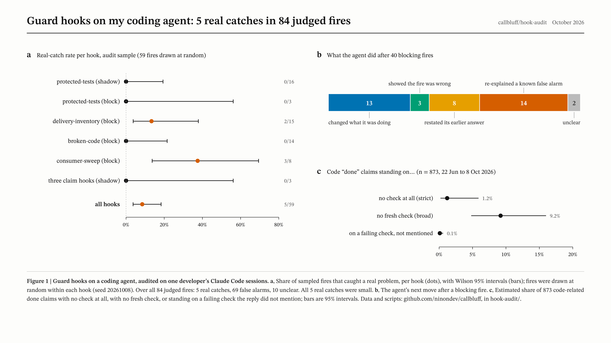

# Hook audit



**Of 84 guard-hook fires judged one by one, 5 caught a real problem, and all 5 were small.** The hooks were there to stop my coding agent from cutting corners, above all from calling work done when it was not. That failure turned out to be rare. Across 873 code-related "done" claims in Claude Code from June to October 2026, about **1.2%** had no check behind them at all (95% CI 0.2% to 5.9%). Counting passing results that were relayed or restated instead of re-run, the figure is **9.2%** (95% CI 4.8% to 16.0%).

This folder has the report, the aggregate tables and the scripts to run the same audit on your own transcripts. One person, one machine and one rater produced these numbers; the limits are listed right after the table.

| What was measured | Result |
|---|---|
| Guard-hook fires judged (59 sampled for this audit + 25 judged earlier) | 5 real catches, 69 false alarms, 10 unclear |
| Real-catch rate in the audit sample | 5 of 59 = 8.5% (Wilson 95% 3.7% to 18.4%) |
| Population-weighted real-catch rate over 306 unjudged fires | about 4.8% |
| "Done" claims found, after removing duplicates | 1,075, of which 873 were about code |
| Code claims with no check at all (strict) | about 1.2% (0.2% to 5.9%) |
| Code claims with no fresh check (broad) | about 9.2% (4.8% to 16.0%) |
| Claims standing on a failing check that the reply did not mention | about 0.1% (upper bound 0.6%) |

None of the 5 real catches was a false "tests pass" claim or broken code. Four were missing doc updates or a process gap the agent had not mentioned; one was a claim about what the screen showed that the agent had not checked.

## Limits, up front

- One person, one machine, one rater. The rater was a Claude model working from the written label rules in this README; every label is that one rater's judgment, with no second rater and no blinding. A human second pass would be the first thing to add.
- The hook fire log covers six weeks (28 August to 8 October 2026). The claim scan covers transcripts from 22 June to 8 October 2026.
- The claim scan sees only checks run through Bash. Checks done in a browser, by a subagent or by another tool are invisible to it. Hand-checking corrects for this, with wide intervals.
- Recall of the claim phrases is unknown. Claims worded in ways the patterns do not match are not counted.
- Claims the scan marked as verified were not hand-checked. A passing check that tested the wrong thing would count as verified.
- 53 of the 306 unjudged fires had no transcript left on disk and could not be sampled.

## Method

**Data.** 597 main-session transcript files (854,976 lines) from `~/.claude/projects`, with benchmark and evaluation folders excluded, plus the fire log my hooks keep.

**Q1: do the guard hooks catch real problems?**

1. The hooks log every fire with time, hook, mode and transcript. A blocking hook stops the agent and tells it why; a shadow hook only logs. Nine hooks fired at least once; 331 fires were logged when the sample was drawn.
2. 25 fires already had a verdict from earlier review. The other 306 were split by hook and mode.
3. From each stratum, a fixed number of fires was drawn at random (seed 20261008) from those whose transcript still existed: 59 fires in total.
4. For each fire, the rater read the transcript around it and labeled it TP (it pointed at a real problem in that session's work), FP (it did not) or UNCLEAR. For blocking fires, the rater also recorded what the agent did next.
5. Rates come with 95% Wilson intervals. The population-weighted rate weights each stratum's TP rate by its unjudged fires.

**Q2: how often is a "done" claim unverified?**

1. A turn runs from one real typed message to the next. System reminders, tool results and task notifications do not start a turn.
2. The last assistant text in the turn is the reply the person reads. It counts as a claim if it contains a completion phrase ("done", "fixed", "all tests pass", "verified" and similar, in English and Chinese), after a short negation filter ("not done yet" is not a claim).
3. The claim is about code if the turn edited a code file, ran a build, test or commit command, or the reply mentions code, tests or builds.
4. The scanner looks back in the turn for Bash commands that are checks (test runners, builds, linters, scripts named like check or verify) and reads the result of the last one.
5. Each claim gets one class: VERIFIED_PASS, UNVERIFIED (no check in the turn), CLAIM_WITH_FAILING_CHECK (last check failed and the reply does not say so), FAILING_CHECK_DISCLOSED, CHECK_OUTCOME_UNKNOWN, or NOT_APPLICABLE (not about code). A turn copied into several files by resumed or forked sessions counts once.
6. The rater hand-checked a random 40 of the 402 UNVERIFIED claims (seed 20261008) and all 33 CLAIM_WITH_FAILING_CHECK claims.
7. **Strict** counts a claim as unverified only when nothing in the turn checked it. **Broad** also counts a claim backed only by a subagent's report that was not re-run, or by a passing count from earlier in the session.
8. The estimate is the flagged share times the hand-checked confirmation rate. The interval is the Wilson interval of the confirmation rate, scaled by the flagged share.

## Results

Guard-hook fires in the audit sample (full table: [data/q1_gate_fires.csv](data/q1_gate_fires.csv)):

The hooks had older names during the audit. Their names in callbluff today: broken-code = execution_check, protected-tests = acceptance_file_guard, delivery-inventory = delivery_inventory, consumer-sweep = consumer_sweep, pilot-first = pilot_first, fake-completion = false_completion, claim-accuracy = duration_claim, claim-evidence = claim_evidence.

| Hook (mode) | Fires when | Unjudged | Sampled | TP | FP | Unclear |
|---|---|---|---|---|---|---|
| protected-tests (shadow) | test or acceptance files are edited | 175 | 16 | 0 | 16 | 0 |
| protected-tests (block) | same | 4 | 3 | 0 | 3 | 0 |
| delivery-inventory | a batch task closes without an item count | 60 | 15 | 2 | 10 | 3 |
| broken-code | edited code has undefined names or syntax errors | 46 | 14 | 0 | 14 | 0 |
| consumer-sweep | a widely used definition changes and its docs do not | 18 | 8 | 3 | 3 | 2 |
| three claim hooks (shadow) | various claim checks | 3 | 3 | 0 | 3 | 0 |
| **All** | | **306** | **59** | **5** | **49** | **5** |

What the agent did after 40 blocking fires ([data/q1_behavior_after_block.csv](data/q1_behavior_after_block.csv)): changed what it was doing 13 times, showed with evidence that the fire was wrong 3 times, restated its earlier answer 8 times, re-explained a false alarm it had already explained 14 times, unclear 2.

"Done" claims by class ([data/q2_claim_classes.csv](data/q2_claim_classes.csv)):

| Class | Claims | Share of code claims |
|---|---|---|
| VERIFIED_PASS | 404 | 46.3% |
| UNVERIFIED (detector, before hand-check) | 402 | 46.0% |
| CLAIM_WITH_FAILING_CHECK (detector) | 33 | 3.8% |
| FAILING_CHECK_DISCLOSED | 17 | 1.9% |
| CHECK_OUTCOME_UNKNOWN | 17 | 1.9% |
| NOT_APPLICABLE | 202 | |

The detector's raw numbers overstate the problem. Of the 40 sampled UNVERIFIED claims, 14 were not about code, 10 had been verified in a way the detector could not see, and 8 were not completion claims. Of the 33 failing-check flags, 32 were wrong: most often the failure was not a test failure (12), the check had in fact passed (8), or the reply did disclose it (6). See [data/q2_handcheck.csv](data/q2_handcheck.csv).

## What did go wrong

The gaps that did show up were harder to see:

- Relaying a subagent's green result without re-running it (3 of the 40 sampled). Synthetic example: a subagent reports "42 passed"; the main reply says "all 42 tests pass", and nothing ran in the main session.
- Restating an old count (4 of 40). Synthetic example: "still 118/118 green", quoting a run from much earlier in the session, after further edits.
- Work that passed its tests and still did not open, or did not take effect, on the machine where it was meant to run. A transcript scan cannot see this; the check that catches it is a person trying the thing. One of the 5 real hook catches was of this kind: a claim about what the screen showed that the agent had not looked at. This report does not count these cases.

## What the hooks did badly, and the fixes

- `broken-code` blamed sessions for files they did not touch. 35 of its 46 fires were the same false alarm: a stray file, never edited by the flagged session, that used Python 3.12 generic class syntax (`class C[T]`) the checker could not parse. Parallel sessions and leftover worktrees caused the same kind of misattribution. Fix: parse current syntax, and check only files the session itself wrote.
- `protected-tests` fired on new files. All 16 sampled shadow fires were new test files or scratch copies, which cannot weaken an existing test. Fix: ignore new files and scratch folders.
- `delivery-inventory` matched completion words anywhere in the reply, with a regex. Fix: fire only on real completion wording.
- `consumer-sweep` was worth keeping: 3 of its 8 sampled fires were real, all small doc fixes. No change.

Outside the sample, one `broken-code` fire did point at a real defect: a deleted function that was still called, left by another session. The blocked session diagnosed it correctly. It is not counted above.

## Run it on your own transcripts

Run these from this folder. The scripts need only Python 3.9 or later and print only aggregate counts. Sample files for hand-checking hold file paths and line numbers, never message text.

```sh
python3 -I scripts/q2_done_claims.py ~/.claude/projects --exclude 'bench|eval'
python3 -I scripts/q2_done_claims.py --per-class 40 --sample-out claims_sample.csv
python3 -I scripts/q2_adjust.py --code-claims 873 --flagged 402 --checked 40 --confirmed 1
python3 -I scripts/q1_hook_fires.py ~/.claude/projects --per-hook 15 --sample-out fires_sample.csv
python3 -I scripts/q1_stats.py fires_sample.csv
```

Without a fire log, `q1_hook_fires.py` finds blocking fires in the transcripts themselves (Stop hook errors, PreToolUse and PostToolUse hook errors). Shadow-mode fires leave no trace there; pass `--firelog` if your hooks keep a log. The tests run every script on a synthetic fixture: `python3 -m unittest`.

## What comes next

The fixed hooks are callbluff itself; see the [main README](../README.md). The open question is whether one person's numbers hold elsewhere. If you run these scripts on your own transcripts, please open an issue with the aggregate tables (no transcript text), and say which hooks you run.

## License

The scripts, text and tables are under the [MIT License](../LICENSE). Copyright (c) 2026 Ninon. See [CONTRIBUTING.md](../CONTRIBUTING.md) to contribute.
